# Diagrama de classes — WXN

Diagrama baseado no código do **PR #9 após a resolução dos conflitos com a main**,
commit `332b0ee` (17/11/2026). O PR ainda precisa da revisão e do merge da equipe.
Os arquivos não representam uma versão futura planejada nem um modelo de tabelas.

## Abrir e compartilhar

- [PDF completo, cinco páginas](diagrama-de-classes.pdf): apropriado para compartilhar ou apresentar; páginas em A2, com orientação conforme a vista.
- [Visualizador offline](index.html): abre no navegador e inclui os fontes Mermaid. Use o zoom e a rolagem para inspecionar as classes.
- [Imagem do domínio](01-dominio.png): para inserir em um documento ou apresentação.

| Vista | Imagem vetorial | Fonte editável |
| --- | --- | --- |
| 1. Entidades e relações de negócio | [SVG](01-dominio.svg) | [Mermaid](01-dominio.mmd) |
| 2. Atendimento e serviços de aplicação | [SVG](02-aplicacao.svg) | [Mermaid](02-aplicacao.mmd) |
| 3. Contratos e adaptadores de persistência | [SVG](03-persistencia.svg) | [Mermaid](03-persistencia.mmd) |
| 4. WhatsApp, IA, HTTP e configuração | [SVG](04-canais-ia-http.svg) | [Mermaid](04-canais-ia-http.mmd) |
| 5. Enumerações, serviços contratados e exceções | [SVG](05-tipos-e-erros.svg) | [Mermaid](05-tipos-e-erros.mmd) |



## Como ler

- `+`: membro público; `-`: membro privado; `$`: operação estática.
- `?` depois de um tipo: valor que admite ausência (`null` ou `undefined`). Os parâmetros e getters exibidos são uma seleção dos principais, para legibilidade.
- `Promise<T>`: operação assíncrona. Os fontes Mermaid escrevem genéricos como `Promise~T~`.
- Triângulo com linha contínua: herança (`Cliente` e `Atendente` herdam de `Usuario`).
- Triângulo com linha tracejada: implementação de interface (os três remetentes implementam `Remetente`).
- Losango vazio: agrupamento todo/parte do histórico; não afirma exclusão em cascata das mensagens.
- Losango preenchido: propriedade do ciclo de vida (`BancoDeDados` cria e encerra seu pool).
- `1`, `0..1` e `0..*`: um, no máximo um, e zero ou vários. As relações de domínio descrevem o modelo; algumas não são verificadas pelo código em memória.
- Setas sem triângulo indicam associação ou dependência; setas tracejadas indicam uso temporário.
- `JSON` abrevia `Record<string, unknown>`; não é uma classe adicional.
- `Usuario` é genérica: `Informacao` vale `string` por padrão, e `Cliente` admite `string | null`. O nome apresentado por `Cliente.getNome()` é sempre texto.

## Decisões para representar o código com fidelidade

- Todas as **35 classes de produção** declaradas em `src/` aparecem em pelo menos uma vista. Classes de teste e detalhes das bibliotecas não são expandidos. Algumas classes/interfaces se repetem para conectar as vistas; são as mesmas definições.
- `Evento.ts` está vazio: não existe uma classe `Evento` implementada. Eventos são registrados por `EventoRepositorio` usando o contrato `NovoEvento`.
- `app.ts` contém a função de montagem `main()`, não uma classe `App`. Ela cria as instâncias, compartilha o pool e a fila e encaminha mensagens primeiro ao `FluxoDoOperador` e depois ao `Atendimento`.
- `RotasDaFila.ts`, `CarregadorDeManual.ts`, `PedidoDeAtendimento.ts`, `OrdemDaFila.ts` e `PrivacidadeDeLog.ts` também contêm funções; não foram transformados em classes fictícias. `PedidoDeAtendimento` é uma interface real e aparece na vista de domínio.
- `ServicoContratado` é uma interface de dados; `StatusServico` é uma união de strings. Nenhum dos dois foi representado como classe concreta ou enum TypeScript.
- Conversas históricas reconstituídas podem ter `chatbot = null`; por isso essa associação usa `0..1`. Uma conversa vazia admite zero mensagens, e um ticket aguardando admite responsável nulo.
- A relação conversa–ticket é de no máximo um ticket por conversa, inclusive encerrados, conforme a restrição do banco. O protocolo é o próprio `Ticket.id`.
- `Prioridade` é um alias de `PrioridadeTicket`; não é um segundo enum.
- O `Chatbot` de domínio participa da regra de limite de falhas. As integrações Gemini ficam em `ClassificadorGemini` e `GeradorGemini`, que implementam contratos diferentes.
- O PR inclui consulta de nome/empresa, limite de tentativas e informações do operador. A consulta de serviços contratados da main foi preservada. As migrações 006 (serviços) e 007 (empresa) são aplicadas pelo mesmo migrador.

## Regenerar os arquivos

Requer Node.js 24. Instale as ferramentas em uma pasta externa ao repositório,
para preservar `package.json` e `package-lock.json` da aplicação:

```bash
# Na raiz do projeto; ative .local-tools/activate.sh se existir.
source .local-tools/activate.sh
PUPPETEER_CACHE_DIR=/tmp/wxn-diagrama-browser npm install \
  --prefix /tmp/wxn-diagrama-tools --no-audit --no-fund \
  @mermaid-js/mermaid-cli@12.2.0 puppeteer@25.18.1 pdf-lib@1.17.1

# Necessário se o npm tiver bloqueado o postinstall do Puppeteer:
PUPPETEER_CACHE_DIR=/tmp/wxn-diagrama-browser \
  node /tmp/wxn-diagrama-tools/node_modules/puppeteer/install.mjs

PUPPETEER_CACHE_DIR=/tmp/wxn-diagrama-browser \
  node docs/diagramas/renderizar.mjs /tmp/wxn-diagrama-tools
```

Edite os `.mmd`, atualize `origem.json` quando o código mudar e regenere as imagens,
o HTML e o PDF. A renderização valida a sintaxe de cada diagrama e verifica que
cada vista ocupa uma página do PDF. Não carrega `.env`, não inicia a aplicação e
não se conecta ao WhatsApp ou ao banco.
